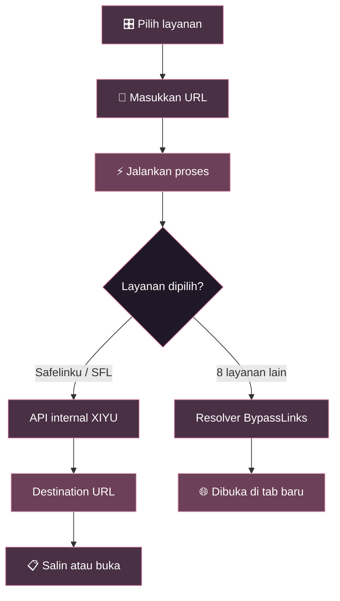

::: {align="center"}
``{=html}

``{=html}
``{=html}
``{=html}

`<br/>`{=html}

### 🔗 Pilih shortlink · Tempel URL · Jalankan proses

`<sub>`{=html}Elegant dark-pink interface • Responsive layout • Animated
UI`</sub>`{=html}
:::

------------------------------------------------------------------------

::: {align="center"}
``{=html}
:::

## 💗 XIYU SKIP SHORTLINK

**XIYU SKIP SHORTLINK** adalah aplikasi web untuk memilih layanan
shortlink, memasukkan tautan, lalu menjalankan alur pemrosesan sesuai
layanan yang dipilih.

Aplikasi mempertahankan UI lama XIYU dengan identitas baru: tema
rose-pink dan charcoal, kartu rounded, efek glow, dropdown berdesain,
serta animasi transisi. Fokusnya tetap sederhana: pengguna memilih
layanan dari atas kolom input, memasukkan URL, lalu menekan tombol
proses.

> **Catatan integrasi:** Safelinku/SFL diproses melalui endpoint API
> XIYU. Delapan pilihan lainnya saat ini membuka resolver eksternal
> BypassLinks di tab baru. Opsi tersebut belum memakai backend internal
> yang sama dengan Safelinku.

::: {align="center"}
``{=html}
``{=html}
``{=html}
:::

------------------------------------------------------------------------

::: {align="center"}
``{=html}
:::

## ✨ Fitur Utama

```{=html}
<table>
```
```{=html}
<tr>
```
```{=html}
<td width="50%" valign="top">
```
### 🎛️ Pemilih shortlink

Dropdown berdesain di atas kolom input. Pengguna dapat memilih layanan
tanpa berpindah halaman.

```{=html}
</td>
```
```{=html}
<td width="50%" valign="top">
```
### 🔗 Input URL

Kolom untuk memasukkan tautan shortlink. Placeholder mengikuti layanan
yang dipilih.

```{=html}
</td>
```
```{=html}
</tr>
```
```{=html}
<tr>
```
```{=html}
<td width="50%" valign="top">
```
### ⚙️ Proses Safelinku

Mengirim URL ke endpoint internal `/api/bypass`, lalu meneruskan request
ke API XIYU.

```{=html}
</td>
```
```{=html}
<td width="50%" valign="top">
```
### 🌐 Resolver eksternal

Delapan pilihan tambahan membuka BypassLinks di tab baru. Hasil
bergantung pada layanan eksternal.

```{=html}
</td>
```
```{=html}
</tr>
```
```{=html}
<tr>
```
```{=html}
<td width="50%" valign="top">
```
### ⏳ Status proses

Alur Safelinku menampilkan status proses dan hasil pemrosesan.

```{=html}
</td>
```
```{=html}
<td width="50%" valign="top">
```
### 📋 Aksi hasil

Destination URL dapat disalin atau dibuka. Tombol reset membersihkan
input dan hasil.

```{=html}
</td>
```
```{=html}
</tr>
```
```{=html}
</table>
```

------------------------------------------------------------------------

::: {align="center"}
``{=html}
:::

## 🔗 Daftar layanan

   \#  Layanan           Integrasi
  ---- ----------------- --------------------
   01  Safelinku / SFL   API XIYU
   02  Linkvertise       Resolver eksternal
   03  Work.ink          Resolver eksternal
   04  LootLabs          Resolver eksternal
   05  Lockr             Resolver eksternal
   06  Rekonise          Resolver eksternal
   07  Boost.ink         Resolver eksternal
   08  Sub2Unlock        Resolver eksternal
   09  AdMaven           Resolver eksternal

------------------------------------------------------------------------

::: {align="center"}
``{=html}
:::

## 🔄 Alur kerja



------------------------------------------------------------------------

::: {align="center"}
``{=html}
:::

## 🚀 Instalasi lokal

**Persyaratan:** Node.js yang kompatibel dengan Next.js project dan npm.

### 1. Masuk ke folder project

``` bash
cd AIXI-SAFELINKU-main
```

### 2. Install dependency

``` bash
npm install
```

### 3. Jalankan development server

``` bash
npm run dev
```

Buka `http://localhost:3000` di browser.

### Build production

``` bash
npm run build
npm start
```

------------------------------------------------------------------------

::: {align="center"}
``{=html}
:::

## ⚙️ Endpoint

### API internal

``` http
POST /api/bypass
Content-Type: application/json
```

Request body:

``` json
{
  "url": "https://sfl.gl/example"
}
```

Route internal meneruskan URL ke API Safelinku XIYU dan mengembalikan
response ke frontend.

### API upstream Safelinku

``` text
https://xiyu-safelinku-api.vercel.app
```

Endpoint yang dirujuk aplikasi:

-   `GET /bypass?url=<shortlink-url>`
-   `GET /bypass?slug=<slug>`
-   `GET /api/health`

Source aplikasi ini menyertakan route proxy Next.js, bukan source
backend upstream.

### Resolver eksternal

Pilihan selain Safelinku membuka resolver dengan URL yang di-encode:

``` text
https://bypass-links.com/?url=<encoded-url>&ref=xiyu
```

Resolver dibuka di tab baru. Jika tidak terbuka, periksa apakah browser
memblokir pop-up.

------------------------------------------------------------------------

::: {align="center"}
``{=html}
:::

## 📁 Struktur project

``` text
AIXI-SAFELINKU-main/
├── app/
│   ├── api/
│   │   └── bypass/
│   │       └── route.ts
│   ├── globals.css
│   ├── layout.tsx
│   └── page.tsx
├── public/
│   └── hero.jpg
├── package.json
└── README.md
```

------------------------------------------------------------------------

::: {align="center"}
``{=html}
:::

## 🎨 Identitas visual

::: {align="center"}
``{=html}
``{=html}
``{=html}
``{=html}
:::

-   **Glassmorphism:** kartu transparan dan efek blur.
-   **Soft glow:** pencahayaan lembut pada elemen visual.
-   **Rounded UI:** komponen dengan sudut membulat.
-   **Responsive layout:** menyesuaikan ukuran layar.
-   **Micro animation:** hover, loading, dropdown, dan transisi.

------------------------------------------------------------------------

::: {align="center"}
``{=html}

``{=html}

`<br/>`{=html}

`<sub>`{=html}© XIYU CODEX. All rights reserved.`</sub>`{=html}
`<br/>`{=html} `<sub>`{=html}XIYU SKIP SHORTLINK · AIXI
PROJECT`</sub>`{=html} `<br/>`{=html}`<br/>`{=html} `<sub>`{=html}🔗
Clean links. Clear flow. ✦`</sub>`{=html}
:::
